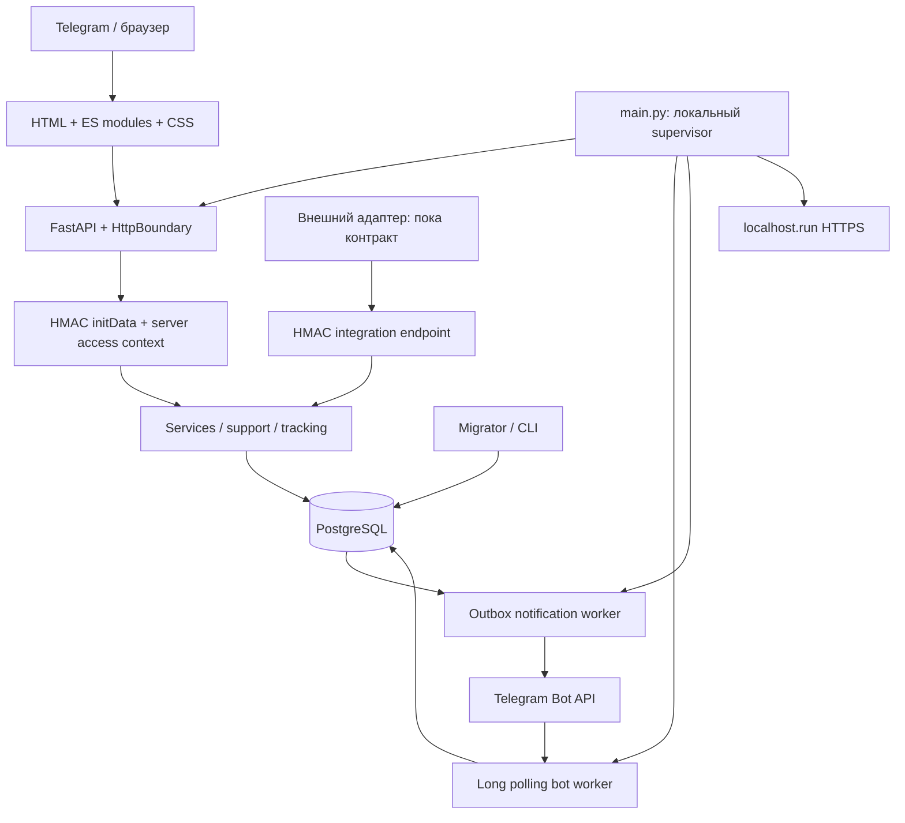

# MAJLIS — технический аудит

Дата: **18 октября 2026 года**. Проверка текущего проекта, а не архива v0.5.

## Вывод

**Допустимо продолжать локальную демонстрацию и контролируемое тестирование на вымышленных данных. Готовность к самостоятельной коммерческой эксплуатации не подтверждена.** Для подключения реальных пользователей необходимо закрыть эксплуатационные условия ниже и устранить подтверждённые дефекты, влияющие на рабочие сценарии. Успешные проектные тесты не покрыли несколько найденных ошибок.

Подтверждено **11 находок: 9 Medium и 2 Low**; Critical/High уязвимости в проверенных сценариях не обнаружены. Это не утверждение об отсутствии неизвестных уязвимостей. Серьёзность оценивается по последствиям и необходимым условиям; недостающие внешние подключения отдельно перечислены как условия запуска, а не представлены как найденные взломы.

Рабочие исходники, `.env` и данные не изменялись. Диагностика выполнялась на копии и в отдельном контейнере PostgreSQL. Доказательства: [манифест версии](evidence/version.json), [хеши исходных файлов](evidence/source-manifest.json), [контроль неизменности](evidence/source-preservation.json).

## 1. Область, версия и ограничения

Проверяемая папка: `/Users/andreyromanov/Desktop/majlis_bot_test/majlis-platform`.

- В этой папке и её родителях Git-репозиторий не найден. Commit и git diff получить нельзя. Это не вывод об отсутствии удалённого репозитория где-либо ещё.
- Вместо commit сохранены SHA-256 файлов. Отпечаток отсортированного манифеста без `data/`: `479cf6618d6284df33413901ffa294dc2678561a0e1e3ad02e0fe16694cd9e03`. Алгоритм: SHA-256 от `json.dumps(manifest_without_data, sort_keys=True).encode()`. В манифесте этой группы 92 файла, включая хеш закрытой конфигурации; значения секретов не скопированы в отчёт.
- API объявляет версию `0.7.0`; актуальный код меню содержит доработку fluid-motion-v5. Это метки исходников, не подтверждение релиза через Git. Источники: [api.py](/Users/andreyromanov/Desktop/majlis_bot_test/majlis-platform/majlis/api.py:38), [ui.js](/Users/andreyromanov/Desktop/majlis_bot_test/majlis-platform/web/ui.js:1).
- Дополнительных файлов AGENTS.md в проверенной иерархии не найдено; применены инструкции из запроса. Старые отчёты и прошлые результаты не засчитывались как сегодняшние доказательства.
- Тестовая копия: `/Users/andreyromanov/Documents/Codex/2026-10-14/new-chat/work/majlis-audit-2026-10-18/project`. Исключены рабочие `.env`, `data/`, настройки запуска IDE и Python cache; создана отдельная фиктивная конфигурация.
- Изолированный PostgreSQL: контейнер `majlis-audit-20261018`, привязка только к `127.0.0.1:55438`, временные данные, отдельные runtime/migrator роли. Рабочий контейнер не перезапускался.
- Старый бот, старая база заказчика, договорённости провайдеров, сервер и реальные платёжные данные не предоставлены. О соответствии первоначальной записи интервью в этом аудите вывод не делается.
- Внешние изменяющие запросы к Telegram, карго и платёжным системам не выполнялись. Реальные ключи не проверялись через внешние сервисы. Рассылок и платежей не было.
- Новые браузерные проверки — обычный браузер с синтетическим подписанным Telegram SDK, реальным backend и CSP. **Не Telegram iOS/Android.** Подлинное получение initData от клиента Telegram и качество отрисовки на телефоне требуют отдельной приёмки.

## 2. Архитектура и источники истины

Стек: Python 3.12, FastAPI/Starlette, Pydantic, psycopg3 + psycopg_pool, PostgreSQL; frontend без сборщика, ES modules и CSS; httpx для Telegram; Docker Compose, Caddy в серверном профиле; SSH localhost.run в локальном. Подтверждение: [requirements.lock](/Users/andreyromanov/Desktop/majlis_bot_test/majlis-platform/requirements.lock), [compose.server.yaml](/Users/andreyromanov/Desktop/majlis_bot_test/majlis-platform/compose.server.yaml), [ARCHITECTURE.md](/Users/andreyromanov/Desktop/majlis_bot_test/majlis-platform/docs/ARCHITECTURE.md).

| Данные / поведение | Фактический источник истины |
|---|---|
| Личность | Серверная проверка подписи initData; клиентские role/id не принимаются вместо неё |
| Права | `MANAGER_IDS`, `manager_access`, `order_managers`; `/manager/` сам по себе прав не даёт |
| Заказы, сумма, владелец, ETA | PostgreSQL; запись через менеджерские API с проверкой версии |
| История покупателя | `events.customer_id` + текущая `customer_generation` |
| Автостатус доставки | Подписанные события адаптера + порядок `sequence` и монотонность стадий; реального адаптера пока нет |
| Трекинг | Вручную введённые номер/перевозчик и время внешнего обновления; онлайн-геолокации нет |
| Оплата | Доверенного подтверждения оплаты в текущей реализации нет; `payment_state=not_confirmed` |
| Платёжная ссылка | Введённый менеджером HTTPS URL из allowlist; удаление локального URL не отзывает внешний счёт |
| Сообщения | Только сообщения этому боту и отправленные через Mini App обращения; не сторонние переписки |
| Уведомления | `outbox` — состояние попыток доставки; `sent` означает успешный ответ Bot API, не прочтение клиентом |

Источники: [domain.py](/Users/andreyromanov/Desktop/majlis_bot_test/majlis-platform/majlis/domain.py:32), [access.py](/Users/andreyromanov/Desktop/majlis_bot_test/majlis-platform/majlis/access.py:6), [services.py](/Users/andreyromanov/Desktop/majlis_bot_test/majlis-platform/majlis/services.py:59), [tracking.py](/Users/andreyromanov/Desktop/majlis_bot_test/majlis-platform/majlis/tracking.py:6), [support.py](/Users/andreyromanov/Desktop/majlis_bot_test/majlis-platform/majlis/support.py:38).

### Запуск и структура

`main.py` читает конфигурацию, блокирует второй локальный launcher, при необходимости поднимает БД, применяет миграции, запускает API, проверяет instance_id по локальному и публичному адресам, запускает bot/notify и следит за туннелем. Серверный профиль разделяет `migrate`, `api`, `bot`, `notify`, `proxy`. CLI: `python -m majlis.cli migrate|api|bot|notify`. Резервные копии/репетиция: `manage.py`. Источники: [main.py](/Users/andreyromanov/Desktop/majlis_bot_test/majlis-platform/main.py:61), [cli.py](/Users/andreyromanov/Desktop/majlis_bot_test/majlis-platform/majlis/cli.py:11).

Разделение backend/domain/access/storage и frontend/views в целом осмысленное. Пул выдаётся через context manager; PostgreSQL-контексты фиксируют транзакции или откатывают их при исключении. Синхронная интеграционная транзакция вынесена из async endpoint в threadpool. Цикла импортов, мешающего импортировать/тестировать приложение, не выявлено. Это не формальное доказательство отсутствия всех динамических импортных циклов.

Сложность сосредоточена в `main.run` (строки 61–257) и frontend `app.js`: там связаны жизненный цикл, состояние и запросы. Конкретная ошибка такого взаимодействия — A04. Выделение отдельного владельца состояния лент оправдано этой ошибкой; переписывать backend или менять стек оснований нет. Источник размеров функций: [source-symbols.json](evidence/source-symbols.json). Ruff проверяет выбранные правила из pyproject.toml, а не все возможные правила качества и сложности.

## 3. Таблица находок

Обозначения: **В** — воспроизведено изолированным тестом/браузером; **С** — непосредственно подтверждено исходником/конфигурацией; **Р** — подтверждённое ограничение, последствия зависят от нагрузки/сбоя. Уровень Medium не означает обход авторизации.

| ID | Уровень | Категория | Суть | Основание |
|---|---|---|---|---|
| A01 | Medium | Доставка / целостность | При смене партии остаются прежние sequence и свежесть внешних данных | В, С |
| A02 | Medium | Readiness | Проверяется ненулевое число миграций, а не полная ожидаемая версия | В |
| A03 | Medium | Уведомления | Потерянный ответ после принятия сообщения допускает повторную отправку | В, Р |
| A04 | Medium | Frontend / гонки | Общий feedBusy подавляет загрузку нового выбранного раздела | В |
| A05 | Medium | CSP / визуальный слой | CSP блокирует динамический style оптической линзы | В |
| A06 | Medium | Аудит денежных изменений | В audit_log не сохраняются старое и новое значения суммы | В, С |
| A07 | Medium | Ограничение запросов | За общим прокси лимит делят разные пользователи | С, Р |
| A08 | Medium | Ресурсы БД | Нет заданных statement/lock/idle transaction timeout | В, С, Р |
| A09 | Low | Наблюдаемость | Ошибки журналируются типом без correlation ID и диагностического контекста | С |
| A10 | Low | Поставка | Базовые Docker images не закреплены digest | С |
| A11 | Medium | Миграции / конфигурация | Не проверяется совпадение целевой БД runtime и migrator | В, С |

### A01 — Партия меняется, порядок событий и свежесть остаются от прежней

**Место:** [services.update_details, строки 281–295](/Users/andreyromanov/Desktop/majlis_bot_test/majlis-platform/majlis/services.py:281), [integration_event, 380–388](/Users/andreyromanov/Desktop/majlis_bot_test/majlis-platform/majlis/services.py:380).

**Причина:** `shipment` редактируется без смены контекста `integration_sequence` и `external_updated_at`. По контракту sequence сравнима в потоке партии, а в таблице хранится непосредственно на заказе.

**Условие и воспроизведение:** событие партии TEST-CARGO с sequence=100 переводит заказ в purchased. Менеджер меняет партию на NEW-CARGO. Подписанное событие новой партии с sequence=1 и status=in_transit получает HTTP 200, но `updated=0`: сравнивается со старым 100. Правильное ожидание `updated=1` провалилось. Следствие сохранения старого timestamp также видно по UPDATE: новая партия может выглядеть обновлённой до своего первого события.

**Последствия:** пропуск актуальных статусов и недостоверная маркировка свежести после перепривязки партии. Конфликт не требует взлома: достаточно допустимого изменения менеджером.

**Исправление:** определить ключ потока `(provider, shipment, generation)`; при изменении партии управляемо сбрасывать/переносить sequence и freshness. Не сбрасывать статус доставки произвольно. Предусмотреть восстановление уже пропущенных событий: их event_id мог быть записан как обработанный, поэтому простого повтора того же события после исправления недостаточно. Нужен контролируемый replay/сверка с источником.

**Проверка:** отдельные счётчики двух партий; перепривязка, повтор и старые события, сохранение delivered. [Красный регрессионный тест A01](../../work/majlis-audit-2026-10-18/checks/test_audit_regressions.py), [вывод](evidence/audit-regressions.txt), [контракт](/Users/andreyromanov/Desktop/majlis_bot_test/majlis-platform/docs/INTEGRATIONS.md).

### A02 — Readiness не подтверждает ожидаемую схему

**Место:** [api.ready, 99–105](/Users/andreyromanov/Desktop/majlis_bot_test/majlis-platform/majlis/api.py:99).

**Причина:** проверяется только `count(schema_migrations)>0`. Нет сравнения имён/checksum с миграциями данной версии.

**Воспроизведение:** только в тестовой БД удалена запись о миграции 007, остальные оставлены. С правильным тестовым health token `/ready` ответил 200 вместо ожидаемого 503. Таблицы намеренно не удалялись: это проверка неполного реестра, а не заявление, что была физически разрушена схема.

**Последствия:** healthcheck может принять старую/несогласованную версию БД; ошибки проявятся на пользовательских маршрутах. Риск особенно важен при запуске API отдельно от migrator.

**Исправление:** проверять ожидаемый набор миграций и checksum; состояния недоступной/неполной БД отдавать как 503. Сохранить токен и закрытый доступ через Caddy.

**Проверка:** пустой, частичный, изменённый и полный реестр; недоступная БД; запуск API с предыдущей версией схемы. [Тест A02 и фактический 200](evidence/audit-regressions.txt).

### A03 — Отправка уведомлений не обеспечивает exactly once

**Место:** [bot.deliver, 142–213](/Users/andreyromanov/Desktop/majlis_bot_test/majlis-platform/majlis/bot.py:142), особенно внешний `send` и последующая запись sent; [Telegram.call, 28–43](/Users/andreyromanov/Desktop/majlis_bot_test/majlis-platform/majlis/bot.py:28).

**Причина:** возможен разрыв между принятием сообщения Telegram и получением/сохранением ответа. Ошибка 0 возвращает запись в pending, истёкшая sending-lease тоже допускает повтор. Уникальность event_id в outbox защищает создание задания, а не внешнее принятие сообщения.

**Воспроизведение:** fake API фиксирует принятие и затем выдаёт TelegramFailure(0); после наступления срока повтора worker вызывает fake API второй раз. Ожидание одной отправки не выполняется: зафиксировано 2 вызова одному синтетическому адресату. **Реальный Telegram не использовался.**

**Последствия:** дубли в неоднозначном сетевом исходе или при падении после send. Это ограничение стратегии доставки, не доказательство постоянных дублей или утечки чужому получателю.

**Исправление:** явно согласовать at-least-once; различать definite failure и unknown outcome, хранить возвращённый message_id при успешном ответе, добавить операторскую диагностику неоднозначных попыток. Рассмотреть обновление известного сообщения вместо создания нового для статусов. Не обещать, что локальный dedupe гарантирует одновременно отсутствие потерь и дублей при потерянном ответе: у проверенного sendMessage нет клиентского idempotency key.

**Проверка:** сбой до принятия, после принятия, после ответа до commit, истечение lease, смена владельца. [Тест A03](evidence/audit-regressions.txt); официальный [sendMessage](https://core.telegram.org/bots/api#sendmessage).

### A04 — Лента остаётся «Загружаем…» после быстрого переключения

**Место:** [web/app.js, loadFeed, 879–906](/Users/andreyromanov/Desktop/majlis_bot_test/majlis-platform/web/app.js:879), вызов при navigate на строках 199–210.

**Причина:** общий флаг `ui.feedBusy` запрещает запрос другой ленты. Старый ответ отклоняется из-за смены `ui.section`, а новый запрос не запускается после finally.

**Воспроизведение:** на стенде ответ activity задержан на 2 секунды. Нажать «Активность», сразу «Обращения». После завершения первого запроса выбранный inbox продолжает показывать «Загружаем…». Ручное «Обновить» восстанавливает загрузку. Браузер и отдельный Node-тест подтвердили проблему.

**Последствия:** менеджер может не увидеть обращения и принять зависание за отсутствие данных; само разграничение прав этим не обходится.

**Исправление:** отдельные поколения/AbortController или pending состояние по разделу; при смене выбранной ленты запустить её запрос независимо от предыдущей. Устаревший ответ не должен снимать busy нового запроса.

**Проверка:** activity→inbox→activity с задержками/ошибками, смена прав во время ожидания, «Загрузить ещё». [Красный тест](../../work/majlis-audit-2026-10-18/checks/feed-race.test.mjs), [вывод](evidence/feed-regression.txt), [DOM](evidence/feed-race.json), [скриншот](evidence/feed-stuck.png).

### A05 — CSP блокирует CSS-алиасы оптической линзы

**Место:** [nav-lens.js, 122–134](/Users/andreyromanov/Desktop/majlis_bot_test/majlis-platform/web/nav-lens.js:122); [http_boundary.py, HEADERS](/Users/andreyromanov/Desktop/majlis_bot_test/majlis-platform/majlis/http_boundary.py:14).

**Причина:** renderer вставляет `<style>` с алиасами ID-селекторов, но политика разрешает только `style-src 'self'`, без подходящего nonce/hash для этого элемента.

**Доказательство:** обычный браузер под реальными CSP-заголовками сгенерировал `securitypolicyviolation`: `directive=style-src-elem`, `blocked=inline`, `source=.../nav-lens.js`, `line=133`. В созданном style было 2005 символов. Отсутствие сообщения в доступном console API не было принято за отсутствие блокировки; записано событие самого браузера. [csp-violation.json](evidence/csp-violation.json).

**Последствия:** часть ID-зависимого оформления зеркального содержимого не применяется. Это объясняет конкретное расхождение оптического слоя; не означает, что всё меню или вся анимация перестают работать.

**Исправление:** вынести стабильные alias-правила в внешний CSS; либо проектировать согласованный nonce-механизм. Не добавлять глобальный unsafe-inline ради эффекта. Изменение должно сохранить sanitization и отсутствие дублирующихся ID.

**Проверка:** сравнить computed styles оригинала/копии при включённой CSP, обе темы и fallback; нет violation, линза не перекрывает hitboxes. Проверить также в Telegram WebView. Официальное описание директивы: [CSP style-src](https://developer.mozilla.org/en-US/docs/Web/HTTP/Reference/Headers/Content-Security-Policy/style-src).

### A06 — Аудит не позволяет восстановить изменение суммы

**Место:** [services.audit, 91–109](/Users/andreyromanov/Desktop/majlis_bot_test/majlis-platform/majlis/services.py:91), `update_commercial`, строки 342–355.

**Причина:** минимизация audit payload исключает amount наряду с именами и секретными URL. У изменения товара/цены остаётся action и версия, но не старое/новое значение суммы.

**Воспроизведение:** менеджер меняет 12001 на 13000 копеек. API отвечает 200; в before_data/after_data amount отсутствует. Красный тест ожидает обе суммы. [Результат A06](evidence/audit-regressions.txt).

**Последствия:** нельзя расследовать цену до/после изменения по журналу. Это пробел доказательности денежных операций, не доказательство подмены суммы покупателем.

**Исправление:** сохранять контролируемый diff суммы, изменённых полей и идентификатора/хеша счёта; не возвращать персональные тексты и полный секретный invoice URL в журнал. Определить доступ и срок хранения такого аудита.

**Проверка:** before/after, actor, версия и timestamp при изменении суммы; цена не теряется, секретный URL в audit не появляется; runtime по-прежнему не может UPDATE/DELETE audit_log.

### A07 — Общий прокси превращает IP-limit в общий лимит пользователей

**Место:** [HttpBoundary, 74–81](/Users/andreyromanov/Desktop/majlis_bot_test/majlis-platform/majlis/http_boundary.py:74), [cli.py](/Users/andreyromanov/Desktop/majlis_bot_test/majlis-platform/majlis/cli.py:34), [Caddyfile](/Users/andreyromanov/Desktop/majlis_bot_test/majlis-platform/Caddyfile).

**Причина:** limiter использует непосредственный peer IP и группу api; proxy_headers=False. Поэтому запросы через один Caddy/туннель делят одну корзину. Текущий конфиг задаёт 240 запросов/мин; пользовательский authenticated limiter дополнительно ограничен 120/мин. Условие известно и честно описано в OPERATIONS.md.

**Последствия:** один клиент/совокупность клиентов может исчерпать общий бюджет, после чего другие получают 429 до проверки личности. Это подтверждённое свойство алгоритма, а не измеренный предел числа клиентов или выполненная внешняя DoS-атака.

**Исправление:** согласовать доверенную границу edge proxy и общий distributed limiter; отдельно ограничивать неавторизованный трафик и проверенную личность. Не доверять произвольному X-Forwarded-For из Интернета. Настроить бюджеты по измерениям, не просто завысить число.

**Проверка:** локальный стенд прокси, несколько синтетических пользователей, spoofed forwarded headers, разные реплики и восстановление окна. Источники: [config-redacted.json](evidence/config-redacted.json), `test_public_limit_before_auth_without_database`, `test_limiter_recovery_and_memory_capacity` в прошедшей Python-серии.

### A08 — Пул ограничен, но время выполнения SQL/ожидания блокировок не ограничено

**Место:** [database.py, 12–34](/Users/andreyromanov/Desktop/majlis_bot_test/majlis-platform/majlis/database.py:12); запросы count/ILIKE в `services.bootstrap`, строки 112–179.

**Причина:** заданы connect_timeout=5 и ожидание пула 10 секунд, но отсутствуют defaults statement_timeout, lock_timeout, idle_in_transaction_session_timeout. На изолированной PostgreSQL все три равны `0` — выключены. [database-settings.json](evidence/database-settings.json). Значения рабочей БД отдельно не считывались, поэтому утверждение об их фактических текущих настройках не делается.

**Последствия:** при блокирующей транзакции или росте выборок соединения могут задерживаться дольше HTTP-клиента; отмена fetch не равна отмене серверного SQL. Это эксплуатационный риск, а не выполненная нагрузочная атака.

**Исправление:** измеренные таймауты на runtime role/connection/transaction, ограничение тяжёлых запросов; обработка timeout с безопасной ошибкой/метрикой. Не копировать короткие runtime-таймауты на миграции и backup без проверки.

**Проверка:** локальная контролируемая блокировка, timeout, rollback и повторное использование соединения; отдельная оценка count/поиска на согласованном объёме. Все проверки — на тестовых данных.

### A09 — Недостаточно данных для расследования ошибки

**Место:** [api.failed, 64–66](/Users/andreyromanov/Desktop/majlis_bot_test/majlis-platform/majlis/api.py:64), [HttpBoundary, 110–115](/Users/andreyromanov/Desktop/majlis_bot_test/majlis-platform/majlis/http_boundary.py:110), [cli.py](/Users/andreyromanov/Desktop/majlis_bot_test/majlis-platform/majlis/cli.py:54).

**Причина:** журнал сохраняет в основном имя класса исключения. Защита от утечки секретов полезна, но нет request ID, пути сбоя/обезличенного traceback и корреляции фоновых ошибок с задачей.

**Последствия:** несколько разных ошибок одного класса трудно различить; оператор получает «проверьте настройки» без достаточной диагностики.

**Исправление:** structured log + correlation ID + безопасные коды ошибок, контролируемое редактирование traceback. Не включать сырые headers/initData, токен в URL httpx, тексты обращений или invoice URL.

**Проверка:** контролируемая ошибка БД/сети различима по request/job ID; тестовый секрет отсутствует во всех логах, клиент получает безопасное сообщение.

### A10 — Mutable Docker tags не обеспечивают идентичность сборки

**Место:** [Dockerfile](/Users/andreyromanov/Desktop/majlis_bot_test/majlis-platform/Dockerfile:1), [docker/Postgres.Dockerfile](/Users/andreyromanov/Desktop/majlis_bot_test/majlis-platform/docker/Postgres.Dockerfile:1), [compose.server.yaml](/Users/andreyromanov/Desktop/majlis_bot_test/majlis-platform/compose.server.yaml).

Используются python:3.12-slim, postgres:17-alpine, caddy:2-alpine без digest. При пересборке содержимое базовых образов может измениться независимо от requirements.lock. Наличие уязвимости этих образов этим аудитом **не установлено**.

**Исправление:** проверенный digest для целевой архитектуры, фиксированный app image tag/digest, SBOM/скан образов и процесс планового обновления. Не закреплять случайный непроверенный digest.

**Проверка:** повторная сборка использует утверждённые базовые образы; есть воспроизводимый rollback и отдельный анализ ОС-пакетов. Compose config проверен, серверная сборка/развёртывание и скан Docker layers не выполнялись.

### A11 — Runtime и migrator могут указывать на разные базы

**Место:** [config.py, postgres_only](/Users/andreyromanov/Desktop/majlis_bot_test/majlis-platform/majlis/config.py:48), [Database.migrate, 36–67](/Users/andreyromanov/Desktop/majlis_bot_test/majlis-platform/majlis/database.py:36).

**Причина:** настройки проверяют протокол URL; migrate проверяет различие имён ролей, но не host/port/database. В test fixture защита от такого несоответствия есть, в обычном запуске — нет.

**Воспроизведение:** в отдельном контейнере runtime направлен на majlis_audit_test, migrator — на majlis_upgrade_test. `migrate()` успешно завершился вместо отказа. Обе базы синтетические, рабочие адреса не использованы. [migration-target-mismatch.json](evidence/migration-target-mismatch.json).

**Последствия:** ошибочная конфигурация может применить DDL/GRANT к другой доступной migrator базе и оставить runtime на старой схеме. Сама по себе эта настройка не даёт удалённому клиенту произвольных прав.

**Исправление:** проверять одну целевую БД и различие ролей до DDL, с учётом допустимого отображения внутренних/внешних адресов; предпочтительно дополнительно сверять идентификатор целевой БД на соединениях. Отказать безопасно, без вывода паролей.

**Проверка:** несовпадение host/port/name, разные роли одной БД, допустимые алиасы; при отказе никакие миграции и ACL не изменены.

## 4. База данных и конкурентность

### Что подтверждено

- 7 файлов миграций, 13 прикладных/служебных таблиц после их применения. PK/FK, unique number, unique outbox.event_id, constraints суммы/статуса, unique идемпотентности обращений присутствуют. Реальное восстановление сравнило 43 ограничения и 2 функции. [Миграции](/Users/andreyromanov/Desktop/majlis_bot_test/majlis-platform/migrations/001_initial.sql), [результат restore](evidence/restore-representative.txt).
- Сумма — BIGINT в копейках, API требует strict int, >0 и ≤1000000000000. Не float. Время событий — TIMESTAMPTZ; ETA — DATE. Единица валюты интерфейса RUB; мультивалютной модели нет. [schemas.py](/Users/andreyromanov/Desktop/majlis_bot_test/majlis-platform/majlis/schemas.py:15), [ui.money](/Users/andreyromanov/Desktop/majlis_bot_test/majlis-platform/web/ui.js:17).
- Менеджерские изменения используют версию и row lock; конфликт устаревшей версии — 409. Событие, audit и outbox записываются в той же транзакции. Подтверждены тестами конкурентных событий, конфликта версии и смены владельца. [pytest.txt](evidence/pytest.txt), [test_security_changes.py](/Users/andreyromanov/Desktop/majlis_bot_test/majlis-platform/tests/test_security_changes.py).
- Запросы со значениями параметризованы; составляемые identifiers используют psycopg.sql. Поля поиска фиксированы, `%`/`_`/escape в поиске экранируются. Тест SQL injection/mass assignment прошёл; это не формальное доказательство отсутствия всех инъекций. [services.bootstrap](/Users/andreyromanov/Desktop/majlis_bot_test/majlis-platform/majlis/services.py:112).
- Runtime/migrator разделены; runtime не superuser, не владелец схемы, не получает DDL/TRUNCATE или UPDATE/DELETE audit_log и прав изменения manager_access. Scoped checks используют функции SECURITY DEFINER с фиксированным search_path и отозванным PUBLIC EXECUTE. Тесты запрещённых операций прошли. Ограничение: это не RLS — доверенный runtime в пределах своих DML прав имеет широкий доступ к таблицам. [database.py](/Users/andreyromanov/Desktop/majlis_bot_test/majlis-platform/majlis/database.py:68), [006](/Users/andreyromanov/Desktop/majlis_bot_test/majlis-platform/migrations/006_lock_manager_permissions.sql).
- Основной список использует keyset id<before; 100 заказов на страницу, 100 событий на заказ. История загружается дополнительными страницами. Bootstrap применяет один lateral-query истории и batch permissions вместо запроса на каждый заказ. Export отдельно ограничен 1000 заказами и 100 событиями каждого: не обещает полный исторический архив. [services.py](/Users/andreyromanov/Desktop/majlis_bot_test/majlis-platform/majlis/services.py:59), [api.export](/Users/andreyromanov/Desktop/majlis_bot_test/majlis-platform/majlis/api.py:238).
- Индексы есть для customer/id, shipment, order history, ownership generation, manager assignments, customer messages и готового outbox. Поиск `%строка%` и полные count требуют оценки объёмов: обычные индексы не гарантируют дешёвый substring search. EXPLAIN на представительном объёме и нагрузочный предел не измерялись.
- Пул закрывается при штатном завершении; notification worker не держит row lock на заказе во время внешнего send, но держит отдельный advisory guard. Тест смены владельца во время отправки прошёл. Не проверялась реальная сетевая partition между guard-сессией и внешним Telegram.

### Миграции и backup

На новой изолированной БД проектные тесты применили 001–007. Дополнительная репетиция: отдельно создана схема только 001, добавлены синтетический заказ на 12345 копеек и история; мигратор применил остальные файлы, повторный вызов успешен, заказ и история сохранились. Проверка checksum изменённой миграции входит в прошедшую тестовую серию. [upgrade.json](evidence/upgrade.json).

Восстановление выполнено реально, не только `pg_restore --list`. Второй dump содержал записи **во всех 13 таблицах**, включая обращения, manager_access, order_managers и legacy_imports. Проектный `restore-test` восстановил в новую БД, сравнил данные/constraints/functions и проверил 23 нарушающих ограничения операции в rollback. Результат: совпадение; файлы dump созданы с 0600. [restore-representative.txt](evidence/restore-representative.txt).

Ограничения репетиции: малый объём, без записи во время dump; владельцы/ACL намеренно исключены; восстановление production-паролей, ролей, TLS, резервного носителя и RPO/RTO не проверялось. Fingerprint сравнивает не все возможные свойства PostgreSQL, поэтому совпадение его отчёта не равно полной сертификации кластера. Расписание, вынос/шифрование копий и alerting не реализованы в предоставленном проекте — внешние настройки не предоставлены. [OPERATIONS.md](/Users/andreyromanov/Desktop/majlis_bot_test/majlis-platform/docs/OPERATIONS.md).

## 5. API — полный перечень маршрутов

Список автоматически извлечён из AST актуального api.py: **29 маршрутов**, включая frontend assets. [routes.json](evidence/routes.json). Назначения и дополнительные объектные проверки ниже.

| Метод | Маршрут | Авторизация | Назначение / права |
|---|---|---|---|
| GET | `/health` | Публичный | Живость процесса; не доступность БД |
| GET | `/ready` | X-Health-Token | Readiness БД, только с health token; Caddy блокирует снаружи |
| GET | `/` | Публичный | HTML оболочка покупателя |
| GET | `/app.js` | Публичный | Статический frontend-файл, не содержит серверных секретов |
| GET | `/ui.js` | Публичный | Статический frontend-файл, не содержит серверных секретов |
| GET | `/nav-lens.js` | Публичный | Статический frontend-файл, не содержит серверных секретов |
| GET | `/theme.js` | Публичный | Статический frontend-файл, не содержит серверных секретов |
| GET | `/style.css` | Публичный | Статический frontend-файл, не содержит серверных секретов |
| GET | `/api/bootstrap` | Подписанный initData | Заказы/сводка/настройки, server-owned scope |
| GET | `/api/orders/{order_id}` | Подписанный initData | Карточка заказа; владелец или назначенный manager |
| POST | `/api/orders` | initData + manager | Создание; can_create и назначение scope |
| POST | `/api/orders/status` | initData + manager | Изменение этапа; edit grant + version |
| POST | `/api/orders/details` | initData + manager | Владелец/имя/партия/ETA; edit + version, явное подтверждение передачи |
| POST | `/api/orders/payment` | initData + manager | Установить/стереть разрешённый HTTPS URL; edit + version |
| POST | `/api/integrations/events` | HMAC интеграции | Тестовый контракт событий доставки; HMAC/time/event_id, production sequence |
| GET | `/api/me/export` | Подписанный initData | Свои текущие заказы/история/сообщения, ограниченный экспорт |
| GET | `/pagination.js` | Публичный | Статический frontend-файл, не содержит серверных секретов |
| GET | `/order-detail.js` | Публичный | Статический frontend-файл, не содержит серверных секретов |
| GET | `/order-editor.js` | Публичный | Статический frontend-файл, не содержит серверных секретов |
| GET | `/api/orders/{order_id}/history` | Подписанный initData | История; объектные права и generation покупателя |
| POST | `/api/orders/commercial` | initData + manager | Товар/сумма; edit + version, очистка локального URL |
| POST | `/api/orders/tracking` | initData + manager | Номер/перевозчик; edit + version |
| GET | `/cabinets.js` | Публичный | Статический frontend-файл, не содержит серверных секретов |
| GET | `/manager` | Публичный | HTML оболочка менеджера; не выдаёт права |
| GET | `/manager/` | Публичный | Та же оболочка менеджера |
| POST | `/api/support` | Подписанный initData | Создать своё обращение; idempotency key и quota |
| GET | `/api/manager/inbox` | initData + manager | Чтение обращений; отдельный can_read_inbox |
| GET | `/api/manager/activity` | initData + manager | Лента изменений заказов в server scope |
| GET | `/workspace.js` | Публичный | Статический frontend-файл, не содержит серверных секретов |

### Проверки контракта

Pydantic запрещает лишние поля; идентификаторы и суммы строго целые, строки ограничены длиной, enum статусов валидируется сервисом. Покупатель не выбирает customer_id для обращения; передача заказа требует менеджерских прав, версии и явного подтверждения. GET не изменяет бизнес-состояние заказа, однако identity обновляет профиль/лимит; это важная операционная особенность, а не чисто read-only транзакция. Источники: [schemas.py](/Users/andreyromanov/Desktop/majlis_bot_test/majlis-platform/majlis/schemas.py), [api.identity](/Users/andreyromanov/Desktop/majlis_bot_test/majlis-platform/majlis/api.py:69).

Идемпотентность различается: создание заказа защищено уникальным number (повтор — 409); обращения — `(customer_id,idempotency_key)` + hash; интеграция — event_id + hash. У всех POST нет единого универсального request-id механизма. Повтор менеджерского изменения со старой version отклоняется 409; после сетевой ошибки клиенту нужно перечитать состояние. Это не повторная финансовая транзакция: платёжного API в приложении нет. Источники: [services.create_order](/Users/andreyromanov/Desktop/majlis_bot_test/majlis-platform/majlis/services.py:203), [support.create](/Users/andreyromanov/Desktop/majlis_bot_test/majlis-platform/majlis/support.py:12).

HMAC интеграции вычисляется по timestamp + точным байтам body, окно 300 секунд; production требует sequence. Повтор идентификатора с иной нагрузкой — 409, неизвестная партия откатывает receipt, старое событие не откатывает delivered. Конкурентные события проверены проектными тестами. Этот контракт — собственный адаптер MAJLIS, а не реализация официального API неизвестного перевозчика. Карго/платёжного провайдера сравнить с документацией невозможно без его названия и контракта. [api.integration](/Users/andreyromanov/Desktop/majlis_bot_test/majlis-platform/majlis/api.py:206), [INTEGRATIONS.md](/Users/andreyromanov/Desktop/majlis_bot_test/majlis-platform/docs/INTEGRATIONS.md).

## 6. Безопасность и персональные данные

| Угроза | Применимость и фактический результат | Граница доказательства |
|---|---|---|
| Подделка Telegram | HMAC-SHA256 с производным ключом WebAppData, constant-time compare; дубликаты query-полей отклоняются | Поддельный/просроченный initData и подмена роли отклонены тестами; реальная подпись от телефона не получалась |
| Replay initData | Допускается использование в течение 3600 секунд, будущая дата — не более 30 секунд | Перехваченный действительный initData является bearer-credential на это окно; отдельной отзывной серверной сессии/выхода нет |
| Повышение прав | Кабинет задаётся заголовком, но manager проверяется сервером; buyer не получает manager из URL | Прошли scoped/global/inbox grant tests; узкие гонки отзыва all_orders внутри уже начатого запроса отдельно не моделировались |
| Чужие заказы/история | Scope, object access, owner generation, очистка URL при передаче | Прошли тесты передачи туда/обратно, экспорта и истории; не ручная проверка каждой комбинации на реальном Telegram |
| SQL injection | Параметры и fixed identifiers; вредоносные фильтры/лишние поля проверены | Подтверждённого SQLi не найдено; не формальная верификация SQL всего проекта |
| XSS | escapeHtml/textContent для имён, товара, notes и сообщений; HTTPS guard для внешних переходов | Статический разбор основных HTML templates; полноценный DOM-fuzzer не запускался |
| CSRF/CORS | Авторизация в нестандартном заголовке, cookie-сессии не используются; CORS middleware с разрешением сторонних origins нет | Классическая cookie-CSRF к этим API неприменима; XSS на своём origin всё равно был бы опасен |
| SSRF | Клиент не получает API произвольной серверной загрузки URL; payment URL открывается в клиенте | operator MINI_APP_URL используется launcher для health; права менять конфиг — отдельная доверенная граница |
| Обход путей | Статика отдаётся фиксированными FileResponse; имена DB/container проходят проверку | Не найден пользовательский file path endpoint; SQL identifiers собираются отдельно от значений |
| Open redirect | Нет HTTP endpoint редиректа на переданный клиентом URL; frontend допускает HTTPS без credentials | Allowlist платежей строгий по hostname; поведение redirect-chain самого платёжного провайдера неизвестно |
| Секреты | Pattern scan исходников нашёл token-pattern только в `.env`; права файла 0600, Desktop 0700; .env/data исключены из Git/Docker context | Не проверялись вся домашняя папка, старые архивы, shell history, IDE history и отсутствующая Git history |
| Debug/служебные API | OpenAPI/docs отключены; /ready закрыт token, Caddy блокирует внешний доступ; /health сообщает живость/instance_id | A02: readiness недостаточен для версии схемы; /health не доказывает работу bot/notify |
| Запросы/ресурсы | POST JSON, ≤65536 bytes с фактическим подсчётом, pre-auth limiter и per-user limiter | Нет отдельного таймера чтения body в HttpBoundary; TLS/proxy slow-client защита и пределы соединений не испытаны |
| Supply chain | Runtime dependencies совпадают с lock, hash-установка прошла; pip-audit по 23 пакетам не нашёл известных записей | Это не анализ ОС/Docker layers/SSH/Telegram SDK; A10 остаётся |

Источники: [domain.validate_init_data](/Users/andreyromanov/Desktop/majlis_bot_test/majlis-platform/majlis/domain.py:32), [http_boundary.py](/Users/andreyromanov/Desktop/majlis_bot_test/majlis-platform/majlis/http_boundary.py), [secret scan, значения скрыты](evidence/secret-scan-redacted.json), [runtime-lock](evidence/runtime-lock-comparison.json), [dependency-audit](evidence/dependency-audit.json), [test_regressions.py](/Users/andreyromanov/Desktop/majlis_bot_test/majlis-platform/tests/test_regressions.py).

Проверка алгоритма initData сверена с официальной [документацией Telegram](https://core.telegram.org/bots/webapps#validating-data-received-via-the-mini-app): используется raw initData на backend, не initDataUnsafe в качестве доверенного решения. Окно 3600 секунд — выбор MAJLIS, а не обязательное значение Telegram. Long polling и сохранение offset сопоставлены с [getUpdates](https://core.telegram.org/bots/api#getupdates); getWebhookInfo проверяется до настройки poller, существующий webhook код не удаляет. Формат menu/inline web_app и sendMessage соответствует проверенным методам Bot API. Реальные настроечные запросы в ходе аудита не выполнялись.

### Данные пользователей

Хранятся Telegram ID, имя, заказы/суммы/адрес внешней оплаты, история, обращения и служебные признаки. Медиа из Telegram представлены типом/подписью, сами файлы не скачиваются. Inbox получает отдельный can_read_inbox; глобальный manager_orders сам по себе этого доступа не даёт. Экспорт покупателя ограничен его текущими данными и явно ограниченным числом записей. Источники: [007 migration](/Users/andreyromanov/Desktop/majlis_bot_test/majlis-platform/migrations/007_manager_workspace_and_support.sql), [support.py](/Users/andreyromanov/Desktop/majlis_bot_test/majlis-platform/majlis/support.py), [PRIVACY.md](/Users/andreyromanov/Desktop/majlis_bot_test/majlis-platform/docs/PRIVACY.md).

Удаление/анонимизация не реализованы как законченная процедура: privacy-plan — dry-run, не исполнение удаления. До реальных данных нужны согласованные сроки хранения, права сотрудников, обработка запросов на выгрузку/удаление, жизненный цикл копий и безопасный канал поддержки. Это технические условия управления данными, а не правовое заключение о соблюдении законодательства. Доступ к реальным backup/поставщику хостинга и договорным требованиям не предоставлен.

## 7. Бизнес-сценарии

| Сценарий | Результат аудита |
|---|---|
| Покупатель/менеджер | Серверные права и scoped кабинеты проверены synthetic API-тестами; /manager/ не скрывает HTML, но не даёт данных без прав |
| Свои заказы | Чужой заказ и manager mutation от покупателя отклоняются; история фильтруется по поколению владельца |
| Создание/изменение | Проверены уникальный номер, strict money, устаревшая version, права readonly/edit и создание назначенного заказа |
| Передача покупателя | Требуется новое имя + подтверждение; старый URL очищается, поколения истории разделены, pending уведомления прежнего владельца отменяются |
| Статусы доставки | Автоматические переходы монотонны; доставленный заказ не откатывается старым событием; ручная коррекция менеджера разрешена отдельно |
| Партия/трек | Ручной трек реализован; A01 ломает смену контекста внешней партии. Нет подтверждённого cargo/delivery adapter |
| Платёжные ссылки | Установка, очистка, allowlist и версия проверены; смена суммы очищает локальный URL. Старый внешний счёт не отзывается автоматически |
| Подтверждение оплаты | Не реализовано. Переход по ссылке не устанавливает paid. Это безопасное отсутствие подтверждения, но незаконченный платёжный процесс |
| Повтор/порядок webhook | HMAC/replay event_id/sequence проверены на собственном тестовом контракте, не на реальном провайдере |
| Уведомления | Очередь/lease/retry/проверка владельца есть; A03 — неизвестный исход может дать дубликат |
| Обращения | Личный отправитель устанавливается сервером, key+hash обеспечивают идемпотентность Mini App; Telegram messages дедуплицируются по chat/message ID |
| Ответы менеджера/вложения | Inbox читает тексты/метаданные, но интерфейса полноценной переписки, ответов и файлового архива нет |
| Перезапуск | Offset/queue хранятся в БД; unit tests проверяют лидерство и retry. Падение worker завершает локальный launcher; нужен операторский restart. Server Compose имеет restart policy |

Источники: [pytest.txt](evidence/pytest.txt), [test_order_updates.py](/Users/andreyromanov/Desktop/majlis_bot_test/majlis-platform/tests/test_order_updates.py), [test_support_workspace.py](/Users/andreyromanov/Desktop/majlis_bot_test/majlis-platform/tests/test_support_workspace.py), [bot.py](/Users/andreyromanov/Desktop/majlis_bot_test/majlis-platform/majlis/bot.py), [config-redacted.json](evidence/config-redacted.json).

### Перенос старой базы

Текущая PostgreSQL — целевая база новой реализации, не предполагаемая старая база. Есть нормализованный контракт, dry-run, конфликт по source/source_order_id + payload_hash, атомарный append-only test import, фильтрация сомнительной истории, отсутствие рассылки при репетиции. Проектные тесты проверяют эти свойства на синтетических JSON. [legacy_import.py](/Users/andreyromanov/Desktop/majlis_bot_test/majlis-platform/majlis/legacy_import.py:124), [test_legacy_import.py](/Users/andreyromanov/Desktop/majlis_bot_test/majlis-platform/tests/test_legacy_import.py).

**Реальная миграция не выполнена и её готовность подтвердить нельзя.** Нужны read-only схема/экспорт, подтверждённое соответствие внутренних клиентов Telegram ID, валюта/единица суммы, принадлежность истории, временные зоны, документы/оплаты, состояния возврата/отмены, freeze/delta/cutover/rollback и сверка. Production import намеренно отсутствует; `apply_test_package` допускает только отдельную *_test БД. [LEGACY-MIGRATION.md](/Users/andreyromanov/Desktop/majlis_bot_test/majlis-platform/docs/LEGACY-MIGRATION.md).

## 8. Frontend / Mini App / Liquid Glass

Подтверждённые сильные стороны: отдельный OrderPages владеет поколением списочных запросов; stale refresh/more ответы отбрасываются, строки дедуплицируются, глубина загруженных страниц перечитывается. Для деталей есть generation guard. Черновики форм, обработка 409 и ограниченные состояния offline/error/empty присутствуют. Переключение тем не пересоздаёт весь UI, хранится отдельно, ошибки localStorage перехватываются. Эти свойства проверяются тестами, но ошибка другого механизма лент A04 показывает, почему нельзя переносить вывод о списках на весь frontend. [pagination.js](/Users/andreyromanov/Desktop/majlis_bot_test/majlis-platform/web/pagination.js), [app.js](/Users/andreyromanov/Desktop/majlis_bot_test/majlis-platform/web/app.js:466), [theme.js](/Users/andreyromanov/Desktop/majlis_bot_test/majlis-platform/web/theme.js).

Браузер: менеджерская оболочка, светлая/тёмная тема, переключение заказов/активности/обращений, зависание A04 и восстановление кнопкой обновления проверены на ширине 390 px. DOM дал scrollWidth=390, то есть горизонтального переполнения в зафиксированном экране нет. Это не проверка всех длинных форм или всех ширин. Скриншоты: [сбой ленты](evidence/feed-stuck.png), [тёмная тема](evidence/theme-dark.png).

Меню: один rAF controller, drag preview отделён от commit, есть cancel и reduced motion. Новая серия из 38 JS-тестов прошла, включая крайние пункты, быструю смену направления, ограничение геометрии, сохранение оптики при перемещении, отсутствие дополнительного кадр-цикла. Это не подтверждение точного сходства с нативным референсом. A05 подтверждён уже с CSP — прежние визуальные результаты не заменяют эту проверку.

Оптический renderer клонирует живой DOM в несколько визуальных слоёв; удаляет ID/обработчики, использует inert/aria-hidden и pointer-events:none, имеет fallback. Клонирование всей длинной страницы и несколько слоёв — потенциальная стоимость CPU/DOM. Во время этого аудита не измерялись frame presentation, p95 latency на слабом телефоне и потребление памяти при большом количестве загруженных страниц. Глобальные listeners контроллера создаются одним экземпляром на жизнь страницы; само их наличие не названо утечкой. [nav-lens.js](/Users/andreyromanov/Desktop/majlis_bot_test/majlis-platform/web/nav-lens.js:53), [ui.js](/Users/andreyromanov/Desktop/majlis_bot_test/majlis-platform/web/ui.js:78).

Есть focus/aria подписи, тема Telegram и безопасные inset, события клавиатуры/viewport. **Не подтверждены в этом проходе:** screen reader VoiceOver/TalkBack, реальная клавиатура iOS/Android, Telegram safe areas, системный reduced motion в реальном WebView и устойчивость анимации на телефоне. Unit-проверки этих веток не заменяют устройство. Не следует переписывать оптику до устранения A05 и повторной проверки с действующей CSP.

## 9. Запуск и эксплуатация

| Критерий | Фактическое состояние |
|---|---|
| Установка | Чистый новый venv, Python 3.12.3, `pip install --require-hashes -r requirements.lock` завершился; pip check без конфликтов |
| Версии | Все 23 locked runtime-пакета совпали с уже установленной рабочей venv; dev requirements не полностью locked |
| Конфигурация | Обязательный токен/схема PostgreSQL и основные пределы валидируются. A11 — разные целевые БД не отклоняются |
| Изоляция среды | Новый тестовый контейнер/порты/роли использованы; project test fixture отвергает небезопасные DB URLs |
| Серверный профиль | `docker compose ... config --quiet` с фиктивными параметрами успешен. Это синтаксическая проверка, не реальный deploy |
| Docker защита | App non-root, read-only rootfs, no-new-privileges, cap_drop ALL; host DB/API ports в server profile не публикуются |
| Health | /health — процесс; /ready — token + DB, но A02; bot/notify собственных health/alerts в коде не имеют |
| Процессы | Локальный launcher контролирует subprocess и закрывает их; server restart policy присутствует. Сетевая авария может завершить worker/launcher; операционный recovery на сервере не испытан |
| Логи | Ограничение размера логов в server profile есть, данные ошибок санитизированы; A09 ограничивает расследование |
| Backup | Реальный restore малой синтетической базы прошёл. Регулярное расписание, отдельный носитель, retention, RPO/RTO и alerting не предъявлены |
| Обновление/откат | Миграции checksummed/advisory lock, документация upgrade есть. Автоматического down-migration/доказанного production rollback нет |
| Доступность | Рабочий конфиг — ENVIRONMENT=test, HTTPS_MODE=localhost_run; постоянного production endpoint в проверенной конфигурации нет |

Источники: [clean-install.txt](evidence/clean-install.txt), [runtime-lock-comparison.json](evidence/runtime-lock-comparison.json), [compose-validation.json](evidence/compose-validation.json), [OPERATIONS.md](/Users/andreyromanov/Desktop/majlis_bot_test/majlis-platform/docs/OPERATIONS.md), [config-redacted.json](evidence/config-redacted.json).

Документация в целом обозначает тестовые ограничения честно. Но утверждение «ready проверяет применённые миграции» нужно уточнить после A02; значения в старых разделах «10 таблиц/15 ограничений» не соответствуют текущему restore-test (13 таблиц/23 фактических reject probes). Заголовок ARCHITECTURE 0.5 дополнен разделами новых версий — лучше привести к единой текущей версии. Это документационные несоответствия, не самостоятельные Critical дефекты.

## 10. Фактически выполненные проверки

| Инструмент/сценарий | Версия / результат | Доказательство |
|---|---|---|
| Python | 3.12.3 | tool-packages + install log |
| PostgreSQL | 17.11 в изолированном контейнере | [database-settings](evidence/database-settings.json) |
| pytest | 9.1.1, 111 passed | [pytest.txt](evidence/pytest.txt) |
| Node.js tests | v24.19.0, 38 passed | [node-tests.txt](evidence/node-tests.txt) |
| Ruff | 0.17.0, выбранные правила — без замечаний | [ruff.txt](evidence/ruff.txt) |
| Bandit | 1.9.4, majlis + main.py + manage.py, 0 предупреждений | [bandit.json](evidence/bandit.json) |
| pip-audit | 2.10.1, 23 locked зависимости, 0 известных записей уязвимостей в полученном ответе | [dependency-audit.json](evidence/dependency-audit.json) |
| Установка | Новый venv, hash verification, pip check успешен | [clean-install.txt](evidence/clean-install.txt) |
| Дополнительные Python регрессии | **4 failed**, ожидают правильного поведения A01/A02/A03/A06 | [audit-regressions.txt](evidence/audit-regressions.txt) |
| Дополнительная Node регрессия | **1 failed**, ожидает загрузку выбранной ленты A04 | [feed-regression.txt](evidence/feed-regression.txt) |
| Браузер/CSP | Подтверждены зависание ленты и style-src-elem violation | [feed-race.json](evidence/feed-race.json), [csp-violation.json](evidence/csp-violation.json) |
| Миграции | Пустая БД + upgrade 001→007 + повтор, сохранён заказ/история | [upgrade.json](evidence/upgrade.json) |
| Restore | Два restore в новые БД; репрезентативный содержит все 13 таблиц | [restore-representative.txt](evidence/restore-representative.txt) |
| Target mismatch | Разные runtime/migration DB приняты — подтверждён A11 | [migration-target-mismatch.json](evidence/migration-target-mismatch.json) |
| Coverage | Branch coverage по baseline Python серии, см. ниже | [coverage.json](evidence/coverage.json) |

**Красные тесты не исправлялись и не ослаблялись.** Они добавлены отдельно от рабочего проекта и ожидают правильный результат. Поэтому 111+38 зелёных проектных тестов и 4+1 красных аудиторских проверок не противоречат друг другу. Для A03 тест формализует желаемое отсутствие дубля в модели неоднозначного внешнего исхода; это не обещание, что exactly once можно обеспечить только исправлением локального кода.

Coverage: 1304/1657 исполняемых строк = **78.70%**; ветви 328/490 = **66.94%**. Расчёт: числитель / знаменатель ×100. Сводное line+branch значение coverage — (1304+328)/(1657+490)×100 = **76.01%**. Проверялись majlis/main/manage, Python baseline 111 tests; отдельные restore/browser/probes в это измерение не включены, JS coverage не измерялось. Проценты не доказывают отсутствие дефектов; новые красные сценарии как раз показывают пробелы набора.

Команды, область сетевых запросов и инструкции повторения: [COMMANDS.md](COMMANDS.md). Версии окружений сохранены в [tool-packages.json](evidence/tool-packages.json), [runtime-packages.json](evidence/runtime-packages.json). Во время проверок были исправлены только диагностические команды с неверной рабочей папкой; первоначальные ошибки запуска не выдаются за дефекты приложения.

## 11. План исправлений и зависимости

### 1. Что блокирует работу с реальными пользователями

1. **Постоянное размещение и восстановление:** постоянный HTTPS, отдельная production-конфигурация/БД, договорённые RPO/RTO, расписание/защита/вынос backup и мониторинг bot/API/queue. Текущий localhost.run и ноутбук не являются доказанной круглосуточной инфраструктурой.
2. **Корректность работы:** A11 и A02 до production migration/deploy; A04 до использования обращений менеджером; A01 до автоматического трекинга и перепривязок партий. Добавленные красные тесты должны стать зелёными без ослабления ожиданий.
3. **Персональные данные:** назначенные сотрудники/минимальные права, согласованные сроки, процедура выгрузки/удаления/backup, операторский контакт. Сейчас SUPPORT_URL пуст и полноценной процедуры удаления нет.
4. **Платежи и интеграции — если входят в обещанный запуск:** данные провайдеров, договорённый mapping и источник paid, подтверждённые webhook, безопасный отзыв/смена счёта. Нельзя запускать эту версию как автоматически подтверждающую оплаты или реально отслеживающую перевозчика.
5. **Приёмка Telegram:** настоящий buyer/manager login, телефонные WebView, потеря сети/повторное открытие/права/платёжные переходы. В этом аудите это не подтверждено.

Для ограниченного ручного кабинета без платежей/карго возможен меньший согласованный объём запуска, но он должен быть явно назван: ручные статусы, отсутствие payment confirmation и операторская поддержка. Такое решение о scope не принято аудитором за владельца продукта.

### 2. Что исправить до расширения тестирования

Порядок по зависимостям:

1. A11 — binding runtime/migrator; затем A02 — точная readiness. Сначала защитить инфраструктурные операции.
2. A01 — контекст партии и сверка пропущенных событий; затем контракт интеграционного replay.
3. A04 — независимые поколения запросов лент. A05 — CSP-compatible стили без unsafe-inline; после этого проверка оптики на устройстве.
4. A06 — воспроизводимый аудит денежных изменений. A03 — выбранная политика unknown outcome, диагностика и операторская процедура.
5. A07/A08 — лимиты и SQL timeout по тестовым измерениям. Затем многопользовательская/многорепличная нагрузочная проверка только своей среды.
6. Тестовая матрица отказов: БД недоступна, рестарт в середине обработки, повтор webhook, изменение владельца, отозванные manager права, очередь failed/unknown.

### 3. Что можно улучшить позже

A09 structured logs/correlation; A10 image digests/SBOM и CI supply-chain scanning; контроль размера DOM оптики, доступность с VoiceOver/TalkBack; унификация документации; оптимизация substring search/summary на измеренном объёме; отдельные модули состояния app.js там, где это уменьшает подтверждённые гонки. Не требуется переписывать приложение с нуля.

### 4. Что не удалось проверить

- Реальную старую базу, полный mapping, cutover/delta и rollback миграции заказчика.
- API/подписи/реальные отказы неизвестных cargo, delivery, website, payment providers.
- Реальное подтверждение/возврат платежа и отзыв внешнего счёта.
- Telegram iOS/Android, настоящий initData, физическую клавиатуру, screen reader и производительность слабого телефона.
- Production DNS/TLS/deploy, восстановление после аварии хоста, внешние backup/alerts, фактические runtime DB timeouts рабочей среды.
- Полный Docker/ОС security scan, Git history и секреты вне текущей папки.
- Большие объёмы, длительные soak tests, query plans на реальной статистике, все сетевые partition и все гонки отзыва прав.

## 12. Итог по критериям готовности

| Область | Оценка по проверяемому критерию |
|---|---|
| Авторизация / объектные права | Базовые и регрессионные сценарии прошли; полного security assurance нет |
| Транзакции / данные | Есть полезные гарантии и успешный restore; A01/A06/A11 требуют исправлений |
| API / frontend | Основные тесты прошли; A04/A05 воспроизведены, A02 — неверный readiness criterion |
| Бот / уведомления | Durable polling/queue есть; внешние исходы at-least-once, production recovery не принят |
| Миграция старого источника | Подготовка/синтетическая репетиция есть; реального переноса нет |
| Платежи / карго | Контракт и ручные ссылки; фактические провайдеры не подключены |
| Локальная демонстрация | Поддерживается проверенной установкой и тестовым запуском |
| Контролируемое тестирование | Возможно на вымышленных данных с явными ограничениями и исправлением найденных UI/данных дефектов |
| Коммерческая эксплуатация | **Не подтверждена; нужны исправления и перечисленные эксплуатационные/внешние приёмки** |

Рабочих исправлений в рамках аудита не выполнено. Новые материалы — только отчёт, доказательства и отдельная диагностическая среда.
