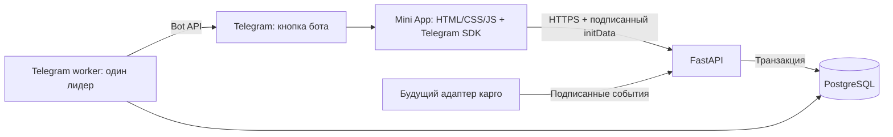

# Архитектура

## Решения, реализованные в коде

Интерфейс и API доступны с одного origin: не нужен открытый CORS и не используются ключи в JavaScript. Пользователь определяется через серверную HMAC-проверку Telegram initData; `initDataUnsafe` не используется как подтверждение личности. Давность входа ограничена одним часом, после истечения нужен повторный вход через Telegram. Роли задаёт только локальная конфигурация сервера.

API и Telegram worker запускаются отдельными процессами. Long polling исключает необходимость публичного webhook для бота. При обнаружении уже настроенного webhook запуск прекращается; чужой webhook не удаляется. PostgreSQL advisory lock не допускает второй worker с той же базой. Конфликт Bot API 409 также завершает процесс.

База доступна локально либо внутри контейнерной сети. `majlis_app` — роль приложения без SUPERUSER/CREATEDB/CREATEROLE; `majlis` — отдельная административная роль PostgreSQL. Приложение владеет собственной базой и схемой для миграций. Для более строгого серверного разделения DDL/DML можно выделить роль мигратора отдельно; в этой версии это не реализовано.

## Данные

| Таблица | Назначение |
|---|---|
| users | Telegram ID, имя, факт старта бота |
| orders | Уникальный номер, клиент, товар, сумма в копейках, партия, этап, дата, версия |
| events | История этапов и источник изменения |
| outbox | Уведомления, попытки, задержка, lease и результат |
| audit_log | Кто и что изменил; снимки до/после |
| integration_events | Защита от повторной обработки внешнего event_id |
| bot_state | Сохранённый offset long polling |
| schema_migrations | Применённые версии SQL и контрольные суммы |
| rate_limits | Ограничение запросов по проверенному Telegram ID |

Сумма хранится целым числом копеек; `12001` означает `120,01 ₽` (12001 / 100). Telegram ID хранится в BIGINT. Даты поставки — DATE, время событий — TIMESTAMPTZ. Ограничения целостности и внешние ключи находятся в SQL-миграции. Индексы поддерживают выборку заказов клиента, партии и очереди.

Изменение этапа, событие, запись аудита и создание уведомления проходят в одной транзакции. Одновременное редактирование защищено row lock и номером `version`: устаревшая форма получает 409. Повторная установка того же этапа не создаёт уведомление. Обратные переходы этапов пока разрешены менеджеру; строгие правила переходов не согласованы с заказчиком.

Очередь использует `FOR UPDATE SKIP LOCKED`, lease на две минуты и повторную отправку с задержкой. После восьми попыток или ошибок 400/403 задача считается failed. Telegram ограничение 429 учитывается через retry_after. При перепривязке клиента старые ожидающие уведомления отменяются; отправка и перепривязка используют общий порядок блокировок. **Отправка имеет семантику at least once:** если Telegram принял сообщение, а процесс упал до записи результата, повторное сообщение возможно. Exactly once не заявляется.

API отдаёт до 100 заказов на страницу и курсор следующей страницы; история загружается одним групповым запросом. Интерфейс содержит «Загрузить ещё». Поиск выполняется на сервере с сохранением границ доступа; фильтры и счётчики учитывают всю доступную выборку. Используется ILIKE с буквальным поиском; отдельный полнотекстовый индекс не реализован.

## Интеграции

`POST /api/integrations/events`: JSON `{event_id, shipment, status}`. Подпись — HMAC-SHA256 по `timestamp + '.' + raw_body`, заголовки `X-Event-Timestamp`, `X-Event-Signature`; допустимая давность ±300 секунд. Нужен секрет не короче 32 символов. Повторный event_id возвращает duplicate без новых изменений. Партия обновляется атомарно. Неподписанные события отвергаются.

`POST /api/orders/payment` хранит только HTTPS-ссылки с точным совпадением разрешённого hostname. Это ручная ссылка; генерация invoice, webhook платежей, возвраты и подтверждение оплаты не реализованы. Их нельзя достоверно написать без выбранного провайдера и его контракта.

Не предусмотрены хранение документов покупателей, банковских карт и паспортов. Резервные копии содержат данные заказов: доступ к ним необходимо ограничивать. Политика сроков хранения и удаления персональных данных требует решения владельца магазина.
