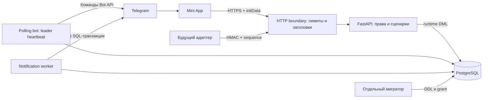

# Архитектура 0.5

## Доступы

Один origin, открытый CORS не используется. Telegram initData проверяется сервером по HMAC, сроку (1 час) и типу ID. Роли задаются конфигурацией, не браузером. Buyer читает только свои заказы/историю текущего поколения. Manager меняет данные по версии записи. GET карточки и истории проверяет права в транзакции с краткой row lock, чтобы не смешать владельцев во время запроса.

Runtime `majlis_app` не владеет таблицами/схемой и не выполняет миграции. `majlis_migrator` владеет проектной схемой, выполняет неизменяемые миграции с SHA-256 и выдаёт явные DML-права. Audit: runtime только INSERT, SELECT/UPDATE/DELETE запрещены. PostgreSQL admin — отдельная роль. На сервере реквизиты мигратора переданы только контейнеру migrate. В локальном .env оба URL есть для PyCharm-launcher: это удобство локальной разработки, не изоляция от процессов того же ОС-пользователя.

## Заказы и история

orders содержит customer_generation и integration_sequence. Передача требует нового имени и transfer_confirmed, сбрасывает платёжную ссылку, отменяет старую неотправленную очередь, увеличивает поколение, добавляет новое событие. events хранит customer_id/customer_generation момента события. Старые события не перемаркируются новому владельцу; неоднозначная legacy-история поколения 0 остаётся у менеджера.

Список — 100 заказов, история — 100 событий с отдельной курсорной загрузкой. В bootstrap история выбирается одной bounded lateral SQL-выборкой, без N+1. Сумма — целое количество копеек, ID — BIGINT, eta — DATE, время — TIMESTAMPTZ. Версия/row lock защищает от потери конкурентных правок. Audit хранит технические поля до/после, не дублирует имена/URL/комментарии.

## Уведомления

Polling и notify — отдельные процессы. Polling держит dedicated session advisory lock и проверяет соединение перед запросом getUpdates; потеря соединения останавливает процесс. Конфликт Bot API 409/401 завершает worker. Чужой webhook не удаляется автоматически.

Notify использует SKIP LOCKED, lease 2 минуты, retry_after/backoff, failed после 8 попыток или 400/403. Сетевая отправка выполняется без открытой транзакции/row lock, под отдельным AUTOCOMMIT session advisory guard владельца. Передача пытается захватить тот же guard и возвращает 409 вместо ожидания. Незавершённая sending-запись также блокирует передачу до восстановления worker; нельзя передать заказ лишь из-за истечения lease. Владелец/поколение перепроверяются перед отправкой, CAS по attempts защищает завершение чужой аренды. Другие правки заказа возможны при отправке.

Доставка at-least-once: сообщение может быть принято Telegram до аварии локального коммита. «Ровно один раз» не гарантируется. Экстремальный обрыв DB-сессии одновременно с внешней отправкой и реальные сетевые отказы требуют отдельной fault-injection приёмки; уже принятые Telegram сообщения отозвать нельзя.

## Интеграции

HMAC timestamp+raw body, окно 5 минут, минимум 32 символа секрета. event_id дедуплицируется, повтор с другой канонической нагрузкой — 409. Обрабатываемые заказы блокируются по возрастанию ID. Для автоматики существующие 7 этапов доставки монотонны; пропущенные промежуточные этапы допустимы. Опциональная sequence защищает от устаревшего события; в production она обязательна. Менеджер сохраняет ручную коррекцию.

Возвратов/отмен нет в исходном словаре; правила новых состояний и соответствие событиям поставщика требуют согласования. Реальных адаптеров карго/доставки/платежей пока нет. Наличие платёжной ссылки не подтверждает оплату.

## Интерфейс и ограничения

pagination.js хранит поколение запросов и глубину страниц; обновление заново читает загруженное количество страниц, изменение фильтра сбрасывает выборку, stale-ответы не меняют новую. order-detail.js/order-editor.js — чистые представления, app.js — взаимодействия/Telegram SDK. Нет локального долговременного хранения заказов. Карточка открывается только после нового API-запроса.

HTTP boundary ограничивает поток body до 64 KiB, ставит заголовки на 413/415/500 и обычные ответы. Pre-auth limiter — ограниченная память, непосредственный IP, без доверия forwarded headers; он локален одному процессу. Общий limiter нескольких серверов, RPO/RTO, сроки хранения и стабильное размещение требуют эксплуатационной настройки. Readiness закрыт токеном и Caddy; лёгкий /health публичен и не использует БД.
